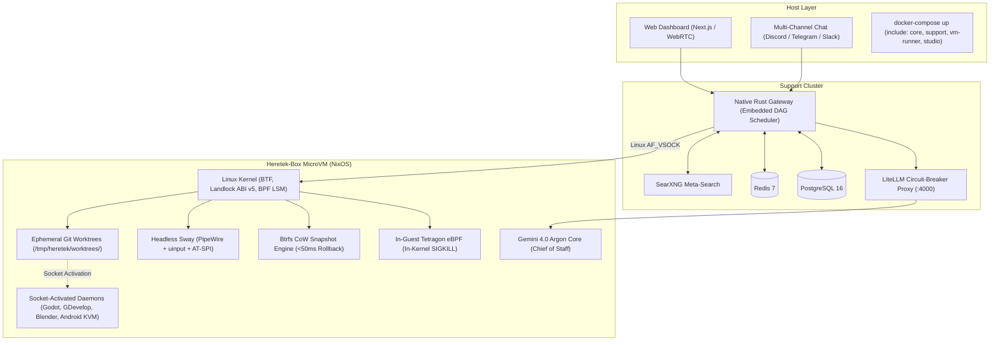

# Heretek-Box 🤖⚡

> **An Autonomous, 100% Agent-Driven Linux Distribution & MicroVM Environment**  
> Operated entirely by **Gemini 4.0 Argon** with a native Rust OpenClaw control plane, LiteLLM quota failover, declarative NixOS impermanence, Btrfs zero-downtime rollbacks, and in-guest Tetragon eBPF containment.

---

## 🌟 Executive Summary

**Heretek-Box** is an operating system and MicroVM environment built from the ground up to be **100% agent-driven**. Rather than treating AI as a sidecar or a chat assistant running inside a user's terminal, Heretek-Box flips the paradigm:

- **The AI core (Gemini 4.0 Argon) is the primary operator of the operating system.**
- The AI autonomously writes code, tests software, browses the web, manages systemd services, provisions declarative environments, and resolves errors.
- **The human interacts through a sleek remote control plane:** a Next.js real-time web dashboard (featuring virtualized `xterm.js` terminals and 60fps WebRTC video streaming) and multi-channel chat gateway bots (Discord, Telegram, Slack).
- **Safety is guaranteed at the kernel and filesystem levels:** in-guest **Tetragon (Cilium) eBPF** system call enforcement with synchronous `SIGKILL`, **Landlock LSM** filesystem sandboxing, and sub-50ms atomic **Btrfs CoW snapshot rollbacks**.
- **Resilience against rate limits:** An internal **LiteLLM / OmniRoute** circuit-breaker automatically catches OpenCode Go 429 quota exhaustion (`GoUsageLimitError`) and fails over across OpenRouter and local vLLM/Ollama models.

---

## 📚 Repository Specification Documents

This repository contains the complete architectural specifications, audit logs, and prompt blueprints developed through an exhaustive 210-question design and adversarial stress-testing process:

| Document | Description |
|---|---|
| 📄 [**`SPEC.md`**](SPEC.md) | **The 8 Hardened Architectural Pillars**: Full architecture diagrams, system topology, hardened microvm engine, impermanence layout, Wayland/AT-SPI control plane, native Rust gateway specifications, LiteLLM failover matrix, and modular `include:` Docker Compose topology. |
| 🗺️ [**`ROADMAP.md`**](ROADMAP.md) | **The 210-Question Architectural Audit Log**: Comprehensive decision log across all 42 batches (Phases 1–9) covering OS virtualization, GUI injection, multi-agent hierarchies, polyglot developer runtimes, autonomous browsing, eBPF security, and the Oct 2026 adversarial audit. |
| 🧠 [**`PROMPT_GEMINI_4_ARGON.md`**](PROMPT_GEMINI_4_ARGON.md) | **Master Argon System Prompt & Kickoff Directives**: Production-ready copy-paste two-tier system prompt (frozen 6,000-token canonical prefix for >90% KV caching), slash command dispatch table, subagent personas (`coder`, `researcher`, `sysadmin`, `appsec_re`, `spatial_mobile`), and the master kickoff prompt to task Argon with repository construction. |
| 🛡️ [**`ADVERSARIAL_ARCHITECTURE_AUDIT_2026.md`**](ADVERSARIAL_ARCHITECTURE_AUDIT_2026.md) | **Adversarial Red-Team Stress-Test Report**: In-depth analysis of OpenCode v2 SQLite lock contention, OpenCode Go rate limit economics, gVisor telemetry blindspots, and active October 2026 open-source tool evaluations. |

---

## 🏗️ Hardened Architecture at a Glance

1. **Declarative NixOS & Hardened Hypervisor**: Powered by `microvm.nix`. Defaults to **Cloud-Hypervisor** run as an unprivileged user (`heretek-vmm`) jailed by host **Landlock ABI v5**, stripping `CAP_SYS_ADMIN` and `seccomp:unconfined`. Host-guest communication via zero-overhead **Linux `AF_VSOCK`**.
2. **Impermanence & Model C Ephemeral Worktrees**: Root filesystem (`/`) runs on ephemeral `tmpfs`. Persistent state is isolated across 4 Btrfs subvolumes (`@persist_sys`, `@workspaces`, `@audit_logs`, `@containers`). Tasks execute in ephemeral Git worktrees in `<100ms`, keeping idle RAM at **~3.5 GB**. Sub-50ms atomic rollback via pre-task snapshots and `cgroup.kill`.
3. **Agent-OS Control Plane**: Headless Sway compositor (`wlroots`), PipeWire audio, `uinput` kernel event injection, and semantic element grounding via `agent-sh/computer-use-linux` (AT-SPI D-Bus accessibility tree + dynamic vision OCR fallback). Central MCP broker with lazy tool discovery.
4. **Native Rust Gateway & Real-Time Web Dashboard**: 24/7 native Rust Gateway daemon with an embedded SQLite/Postgres DAG task scheduler (ported from The-Agency) eliminating JS/Bun runtime overhead, pooled HTTP keep-alive, and Redis Stream buffering.
5. **Polyglot Developer Toolchain & Socket Daemons**: `devenv.sh` environments, standalone Astral `uv` (Python), dual Node.js/Bun (JS/TS), `@ast-grep/cli` structural AST refactoring, and on-demand socket-activated systemd user services (Blender headless, Godot 4.x, GDevelop AST, Android API 35 KVM emulator) that auto-terminate after 10 minutes of inactivity.
6. **Autonomous Web Browsing & Scraping Pipeline**: Self-hosted **SearXNG** meta-search on `127.0.0.1:8888`, **Crawl4AI** for sub-200ms Fit Markdown extraction, and Steel-stealth Chromium with fingerprint randomization and indirect prompt injection (IPI) boundary defenses.
7. **In-Guest eBPF Security & Containment**: **Tetragon (Cilium)** deployed **inside the guest kernel** with BTF support for 100% syscall visibility and synchronous in-kernel `SIGKILL` enforcement. Host Landlock confinement. Direct Argon orchestration of `nuclei`, `semgrep`, `morluto/rea`, and `radareorg/radare2-mcp` (dropping PentAGI to eliminate docker.sock root vulnerability).
8. **LiteLLM Circuit-Breaker & Modular Compose Packaging**: Multi-file Docker Compose architecture using `include:` directive (`compose/core.yml`, `compose/support.yml`, `compose/vm-runner.yml`, `compose/studio.yml`). Internal **LiteLLM proxy** automatically catches OpenCode Go HTTP 429 quota exhaustion and fails over across OpenRouter and local vLLM models.

---

## 🚀 How to Build with Gemini 4.0 Argon

To task **Gemini 4.0 Argon** with implementing Heretek-Box:

1. Open [**`PROMPT_GEMINI_4_ARGON.md`**](PROMPT_GEMINI_4_ARGON.md).
2. Copy the **Two-Tier System Prompt** (with the frozen 6,000-token canonical prefix) into your Argon agent harness configuration.
3. Execute the **Project Kickoff Directive** to begin autonomous scaffolding.
4. Reference [**`SPEC.md`**](SPEC.md) and [**`ROADMAP.md`**](ROADMAP.md) for full architectural invariants.

---

## 📜 License

Heretek-Box is open-source software licensed under the [Apache 2.0 License](LICENSE).
