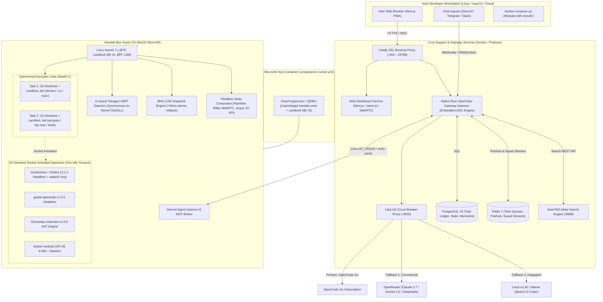

# Heretek-Box: Comprehensive Technical Specification

> **Repository:** [`https://github.com/Heretek-AI/Heretek-Box`](https://github.com/Heretek-AI/Heretek-Box)  
> **Core Objective:** An autonomous, 100% agent-driven Linux distribution and MicroVM environment operated entirely by **Gemini 4.0 Argon**, featuring a Next.js/React task control plane, native Rust OpenClaw Gateway with embedded DAG scheduling, LiteLLM quota-failover circuit breaking, declarative NixOS impermanence, Btrfs zero-downtime atomic rollbacks, in-guest Tetragon eBPF enforcement, and modular Docker Compose packaging.

---

## 1. System Architecture & Component Topology

Heretek-Box operates as a hardware-isolated, multi-tier distributed cluster deployed via modular Docker Compose files (`include:`). The host environment manages hardware acceleration (`/dev/kvm`, `/dev/net/tun`), while internal services isolate control plane, storage, web scraping, API proxying, and agent compute.



---

## 2. The 8 Hardened Architectural Pillars

### Pillar 1: Base Distro & Hardened Virtualization Engine
* **Base OS:** Declarative **NixOS** configured via modular flakes (`nix/core`, `nix/microvm`, `nix/agent`, `nix/gateway`, `nix/profiles`).
* **MicroVM Hypervisor:** Pluggable backend managed by `microvm.nix`:
  * **Cloud-Hypervisor (Rust-native):** Default for ultra-fast, memory-safe headless tasks, virtiofs with DAX, and minimal attack surface.
  * **QEMU:** Swapped dynamically when virtual display / GPU acceleration (`virtio-gpu` with Vulkan Venus or VFIO passthrough) is required.
* **Hardened VMM Isolation:**
  * Runs as an **unprivileged user (`heretek-vmm`)** on the host.
  * Strips `CAP_SYS_ADMIN` and `seccomp:unconfined`. Jailed by **Host Landlock ABI v5** restricting `ioctl` access strictly to `/dev/kvm` and `/dev/net/tun`.
* **Cold Boot Target:** Sub-2-second cold boot enabled by stripping unneeded kernel modules and parallelizing systemd unit activation.
* **Host-Guest IPC Bridge:** Linux VSOCK (`AF_VSOCK`) + virtio-serial, providing zero-overhead kernel socket transport immune to external network firewalls and eavesdropping.

---

### Pillar 2: Impermanence, Filesystem & Rollback Engine
* **Impermanence Layout:** Root filesystem (`/`) runs purely on ephemeral `tmpfs` and resets on reboot. Persistent state is bound to copy-on-write (CoW) Btrfs subvolumes under `/nix/persist`:
  * `@persist_sys`: Declarative Nix configurations, machine credentials, and system state.
  * `@workspaces`: Active project workspaces, source repositories, and scratch spaces.
  * `@audit_logs`: Immutable, append-only, SHA-256 hash-chained execution logs.
  * `@containers`: Rootless Podman container image layers and volumes.
* **Execution Density (Model C):**
  * Subagents execute in **ephemeral Git worktrees** (`/tmp/heretek/worktrees/<task_id>`) in `<100ms`.
  * Toolchains provision on-demand via `devenv.nix` and `uv` from a deduplicated `/nix/store`, keeping idle RAM at **~3.5 GB**.
* **Rollback Mechanics:**
  1. Every task execution or `DANGEROUS` action triggers a pre-execution Btrfs snapshot (`pre-task-<task_id>`).
  2. If an action fails or the user triggers `/rollback`, the daemon sends `1` to `cgroup.kill` to terminate rogue processes.
  3. The broken subvolume is atomically moved to `.quarantine/` and the read-only snapshot cloned in `<50ms` without restarting the VM.
* **Pruning:** Exponential retention (keep 10 latest task snapshots, 1 daily for 7 days, 1 weekly for 4 weeks) with auto-pruning if free disk falls below 15%.

---

### Pillar 3: Agent-OS Control Plane (Wayland, AT-SPI, PTY & MCP)
* **Headless Display Server:** Headless Sway compositor running on `wlroots` with virtual output buffers.
* **UI Inspection & Grounding:**
  * **AT-SPI Accessibility Tree:** Direct D-Bus queries via `agent-sh/computer-use-linux` (active Oct 2026) reading button labels, roles, input values, and focus states deterministically without OCR latency.
  * **Dynamic Vision Fallback:** Screenshot capture via `wlr-screencopy` and high-resolution OCR bounding boxes when apps lack AT-SPI support.
* **Input Injection:** Direct kernel-level `uinput` + Wayland `wlr-virtual-pointer` emitting evdev hardware events.
* **Terminal Engine:** Persistent Pseudo-Terminal (PTY) multiplexer over Unix Domain Sockets preserving shell environment, interactive input, signal traps (`SIGINT`), and ANSI formatting.
* **MCP Broker:** Central Rust daemon multiplexing Model Context Protocol (MCP) servers over Unix sockets with **Lazy Tool Discovery** (`search_tools`, `invoke_tool`, `inspect_schema`) to prevent context window bloat.

---

### Pillar 4: Native Rust OpenClaw Gateway & Real-Time Web Dashboard
* **Native Rust Gateway Daemon:** Long-lived Rust process running 24/7 on host/container, replacing the Bun runtime layer.
  * **Embedded DAG Scheduler:** Native SQLite/PostgreSQL DAG task scheduling ported from [The-Agency](https://github.com/Heretek-AI/The-Agency), eliminating the Bun runtime layer and memory/socket leaks.
  * **Pooled HTTP Keep-Alive & Redis Stream Buffering:** Prevents ephemeral port exhaustion (`ECONNRESET`) and SSE subscriber overflow (`SubscriberOverflowError`).
* **Frontend Tech Stack:** Next.js / React with Tailwind CSS, shadcn/ui, virtualized `xterm.js` terminals, and low-latency WebRTC PipeWire screen video streaming at 60fps.
* **Multi-Channel Integrations:**
  * **Discord:** Rich embeds, interactive action buttons (`[Approve Once]`, `[Reject]`, `[Rollback]`), 1-to-1 thread mapping per task.
  * **Telegram:** Inline keyboard callback queries and voice memo transcription via local Whisper.
  * **Slack:** Interactive Block Kit action cards and workflow triggers.
* **Notification Streamlining:** Collapsible progress cards with real-time in-place message editing to avoid channel spam.

---

### Pillar 5: Polyglot Developer Runtimes & Socket-Activated Studio Daemons
* **Per-Project Isolation:** Declarative `devenv.sh` environments (`devenv.nix`) auto-provisioning exact language toolchains without root pollution.
* **Language Engines:**
  * **Python:** Standalone Astral `uv` toolchain (`uv venv`, `uv pip`, `uv run`) for millisecond dependency resolution.
  * **JS/TS:** Dual engine (`Node.js`/`pnpm` for deterministic lockfiles + `Bun` for instant test running and script execution).
  * **Native Systems:** LLVM / GCC toolchains with `ccache` build acceleration.
* **Structural Code Refactoring:** `@ast-grep/cli` MCP server with `ast-grep outline` for token-efficient file outlines and syntax-safe AST rewrites.
* **Compiler Diagnostics:** Real-time LSP-over-MCP diagnostics (`rust-analyzer`, `pyright`, `gopls`, `vtsls`, `clangd`) pushed directly into tool responses.
* **On-Demand Socket-Activated Studio Daemons (10-Minute Idle Timeout):**
  * **Blender 3D:** Headless automation via `sandraschi/blender-mcp` (active Oct 2026, 150+ tools).
  * **Godot Game Engine:** Headless companion via `Heretek-AI/godot-opencode` (v1.0.0).
  * **GDevelop 2D:** AST game mutation via `Heretek-AI/GDevelop-Unlocked` (v1.0.0).
  * **Android Emulation:** KVM emulator via `budtmo/docker-android` (API 35) + `mobile-dev-inc/maestro` declarative automation.

---

### Pillar 6: Autonomous Web Browsing & Scraping Pipeline
* **Browser Engine:** Self-hosted Chromium powered by **Steel Browser** stealth patches and Playwright, equipped with CDP endpoints.
* **Anti-Detection:** Canvas fingerprint randomization, WebGL vendor masking, AudioContext noise, and `navigator.webdriver=false` overrides.
* **CAPTCHA Handling:** 3-tier resolution:
  1. Stealth prevention via persistent browser profiles.
  2. Automated token solving plugin (NopeCHA / Capsolver API).
  3. Interactive human takeover modal in Web UI video stream.
* **Fast-Path Web Scraping:** **Crawl4AI** engine converting web pages into clean, BM25-filtered Fit Markdown in `<200ms` without spinning up Chromium.
* **Local Search:** Self-hosted **SearXNG** instance on `127.0.0.1:8888` backed by Redis, aggregating Google, Bing, DuckDuckGo, and Arxiv without API keys or tracking.
* **Indirect Prompt Injection (IPI) Defense:** Strips hidden CSS elements (`display: none`, tiny fonts); wraps untrusted web text in `<untrusted_web_data url="...">` boundary tags.

---

### Pillar 7: Security Guardrails, In-Guest eBPF & Containment
* **Kernel Enforcement:** **Tetragon (Cilium)** eBPF engine deployed **inside the MicroVM guest kernel** with BTF support, capable of in-kernel `SIGKILL` enforcement before unauthorized syscalls return. (Replaces gVisor to prevent eBPF telemetry blindspots).
* **Filesystem Jailing:** Linux **Landlock LSM** confining untrusted test, build, and subagent processes strictly to their active `/workspaces/<task_id>` directory and `/tmp`.
* **Autonomous AppSec & Reverse Engineering:**
  * **Drop `vxcontrol/pentagi`:** Eliminates the security hazard of mounting host `/var/run/docker.sock`.
  * **Direct Tool Orchestration:** Argon orchestrates `nuclei`, `semgrep`, and `nmap` within sandboxed, airgapped network namespaces.
  * **Binary Analysis:** Powered by `morluto/rea` (active Oct 2026) + `radareorg/radare2-mcp` (<30MB RAM footprint, sub-10ms startup).
* **Command Risk Tiers:**
  * `SAFE`: Read-only, git status, tests, dev servers -> Autonomous.
  * `CAUTION`: File overwrites, package installation, branch modifications -> Autonomous with audit logging.
  * `DANGEROUS`: `sudo`, `rm -rf`, disk formatting, firewall edits, `/etc` modifications -> Pauses for interactive HitL approval card with diff preview and pre-task snapshot.
* **Secret Redaction:** Real-time entropy and regex sanitizer scrubbing API keys from terminal stdout, logs, and chat streams.
* **Emergency Sever:** Automated kill-switch severing virtual TAP interfaces and freezing VM RAM upon detected intrusion attempts.

---

### Pillar 8: Model Quota Circuit-Breaker & Modular Compose Packaging

#### Model Quota & Failover Architecture
To defeat the OpenCode Go `$12 / 5-hour` rolling quota choke-point (`GoUsageLimitError`), a local **LiteLLM / OmniRoute** proxy sits between the Gateway and LLM providers:

| Tier | Primary OpenCode Go Model | Tier 1 Commercial Fallback (OpenRouter / Direct) | Tier 2 Local Airgapped Fallback | Trigger Condition |
|---|---|---|---|---|
| **Frontier** (Director, Architect) | `opencode-go/qwen3.7-max` (or Gemini 4.0 Argon) | `anthropic/claude-3.7-sonnet` or Google AI Studio | Local vLLM: `Qwen2.5-Coder-32B-Instruct` | HTTP 429, 503, or latency > 45s |
| **Standard** (Systems Builder, Coder) | `opencode-go/kimi-k2.7-code` | DeepSeek Direct: `deepseek-chat` (V3) / Llama-3.3-70B | Local vLLM: `Qwen2.5-Coder-14B-Instruct` | HTTP 429, 500, or context > 64k |
| **Fast** (Web Scout, Scrapers) | `opencode-go/deepseek-v4-flash` | DeepSeek Direct: `deepseek-chat` / Groq: `llama-3.1-8b` | Local Ollama: `qwen2.5-coder:7b-instruct` | HTTP 429 or rate limit |
| **Review** (SRE, Invariant Auditor) | `opencode-go/deepseek-v4-pro` | OpenRouter: `openai/gpt-4o` / Claude 3.5 Haiku | Local vLLM: `Qwen2.5-Coder-32B-Instruct` | HTTP 429 or structured schema error |

#### Canonical 6,000-Token Prefix Rule
To achieve **>90% prompt cache hit rates** on DeepSeek and Gemini:
1. Standardize the first 6,000 tokens across all personas (tool manifests, core axioms, OS architecture).
2. Append dynamic timestamps, task IDs, and specific persona specializations strictly at the tail.

#### Modular Compose Topology
The root `docker-compose.yml` orchestrates modular service files via the `include:` directive:

```yaml
# /home/john/Projects/Heretek-Box/docker-compose.yml
version: "3.9"

include:
  - compose/core.yml           # Gateway, Caddy SSL, WebUI
  - compose/support.yml        # PostgreSQL 16, Redis 7, SearXNG, LiteLLM
  - compose/vm-runner.yml      # Hardened Cloud-Hypervisor MicroVM Engine
  - compose/studio.yml         # Optional host profiles: Android KVM, Blender
```

##### 1. `compose/core.yml`
```yaml
version: "3.9"

services:
  gateway:
    image: ghcr.io/heretek-ai/heretek-gateway:latest
    container_name: heretek-gateway
    restart: unless-stopped
    ports:
      - "18789:18789"
    environment:
      - LITELLM_URL=http://litellm:4000
      - DATABASE_URL=postgres://${POSTGRES_USER:-heretek}:${POSTGRES_PASSWORD:-secret}@postgres:5432/${POSTGRES_DB:-heretek_box}
      - REDIS_URL=redis://redis:6379/0
      - SEARXNG_URL=http://searxng:8080
      - DISCORD_BOT_TOKEN=${DISCORD_BOT_TOKEN:-}
      - TELEGRAM_BOT_TOKEN=${TELEGRAM_BOT_TOKEN:-}
      - SLACK_BOT_TOKEN=${SLACK_BOT_TOKEN:-}
      - VSOCK_PATH=/run/heretek/vsock.sock
    volumes:
      - heretek_persist:/nix/persist
      - vsock_socket:/run/heretek
      - ./workspaces:/workspaces
    depends_on:
      postgres:
        condition: service_healthy
      redis:
        condition: service_healthy
      litellm:
        condition: service_started

  webui:
    image: ghcr.io/heretek-ai/heretek-webui:latest
    container_name: heretek-webui
    restart: unless-stopped
    ports:
      - "3000:3000"
    environment:
      - NEXT_PUBLIC_GATEWAY_WS=ws://localhost:18789
      - NEXT_PUBLIC_WEBRTC_URL=http://localhost:18789/webrtc
    depends_on:
      - gateway

  caddy:
    image: caddy:2-alpine
    container_name: heretek-caddy
    restart: unless-stopped
    profiles: ["ssl"]
    ports:
      - "80:80"
      - "443:443"
    volumes:
      - ./config/caddy/Caddyfile:/etc/caddy/Caddyfile:ro
      - caddy_data:/data
      - caddy_config:/config
    depends_on:
      - webui
      - gateway
```

##### 2. `compose/support.yml`
```yaml
version: "3.9"

services:
  litellm:
    image: ghcr.io/berriai/litellm:main-latest
    container_name: heretek-litellm
    restart: unless-stopped
    ports:
      - "4000:4000"
    environment:
      - OPENCODE_API_KEY=${OPENCODE_API_KEY:-}
      - OPENROUTER_API_KEY=${OPENROUTER_API_KEY:-}
      - GEMINI_API_KEY=${GEMINI_API_KEY:-}
    volumes:
      - ./config/litellm/config.yaml:/app/config.yaml:ro
    command: ["--config", "/app/config.yaml", "--port", "4000"]

  postgres:
    image: postgres:16-alpine
    container_name: heretek-postgres
    restart: unless-stopped
    environment:
      POSTGRES_USER: ${POSTGRES_USER:-heretek}
      POSTGRES_PASSWORD: ${POSTGRES_PASSWORD:-secret}
      POSTGRES_DB: ${POSTGRES_DB:-heretek_box}
    volumes:
      - postgres_data:/var/lib/postgresql/data
    healthcheck:
      test: ["CMD-SHELL", "pg_isready -U ${POSTGRES_USER:-heretek}"]
      interval: 5s
      timeout: 5s
      retries: 5

  redis:
    image: redis:7-alpine
    container_name: heretek-redis
    restart: unless-stopped
    command: ["redis-server", "--appendonly", "yes"]
    volumes:
      - redis_data:/data
    healthcheck:
      test: ["CMD", "redis-cli", "ping"]
      interval: 5s
      timeout: 3s
      retries: 5

  searxng:
    image: searxng/searxng:latest
    container_name: heretek-searxng
    restart: unless-stopped
    environment:
      - SEARXNG_BASE_URL=http://localhost:8888/
    volumes:
      - ./config/searxng:/etc/searxng:ro
    depends_on:
      - redis
```

##### 3. `compose/vm-runner.yml`
```yaml
version: "3.9"

services:
  vm-runner:
    image: ghcr.io/heretek-ai/heretek-vm-runner:latest
    container_name: heretek-vm-runner
    restart: unless-stopped
    user: "1000:1000" # Unprivileged heretek-vmm
    devices:
      - /dev/kvm:/dev/kvm
      - /dev/net/tun:/dev/net/tun
    cap_drop:
      - ALL
    cap_add:
      - NET_ADMIN # Strictly for TAP interface creation
    volumes:
      - heretek_persist:/nix/persist
      - vsock_socket:/run/heretek
      - ./workspaces:/workspaces
    depends_on:
      - gateway
```

##### 4. `compose/studio.yml`
```yaml
version: "3.9"

services:
  android-studio:
    image: budtmo/docker-android:emulator_15.0
    container_name: heretek-android-emulator
    restart: unless-stopped
    profiles: ["mobile"]
    devices:
      - /dev/kvm:/dev/kvm
    environment:
      - DEVICE=Samsung Galaxy S10
    ports:
      - "6080:6080"
    volumes:
      - android_data:/root
```
